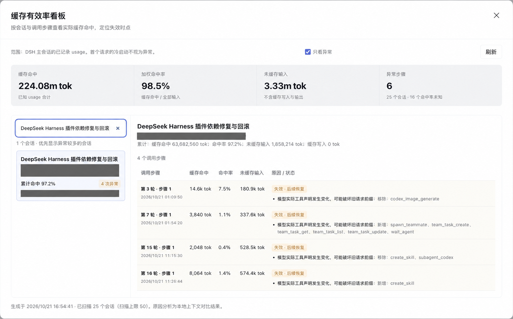
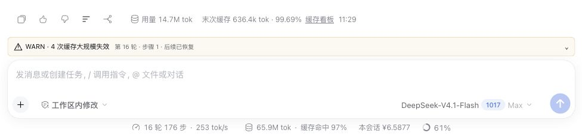
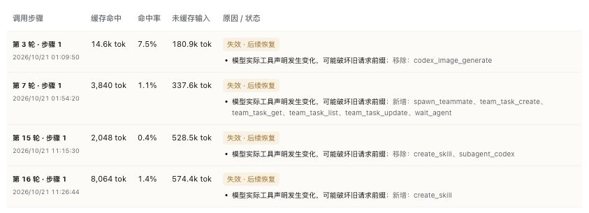

# dsh-cache-helper

为 DeepSeek Harness（DSH）显示实际缓存命中量，在发送前确认大规模缓存风险，并保留异常记录与会话统计看板。

**当前版本：0.1.2。** 源码位于本仓库，预构建安装包通过 [GitHub Releases](https://github.com/ghang/dsh-cache-helper/releases) 提供；npm 与插件榜收录分别记录。已验证的宿主环境为 DSH `0.2.1-rc.2` 的 `web` profile；其他版本仍需验证。

## 功能

| 功能 | 行为 |
|---|---|
| 每轮末次缓存 | 在回答底部的“用量”后、时间前显示该轮最后一次实际模型调用的缓存读取 Token 和命中率；悬停查看步骤与精确值 |
| 发送前确认 | 上下文组装完成后比较上次实际请求的有效前缀；预计大规模损失时暂停，点击“确认并发送”才继续 |
| WARN | 在输入框上方保留异常轮次、步骤、实际指标和差异线索；后续恢复命中仍保留记录，可展开、收起 |
| 缓存看板 | 在“设置 → 缓存看板”查看会话累计指标和步骤明细，支持搜索、异常筛选和翻页；回答尾部也有快捷入口 |

默认确认阈值是预计损失 **至少 50,000 tok，且达到上次输入的 20%**。首次冷启动正常放行；正常追加输入不算旧前缀损失。支持历史工具更新的模型按实际工具投影比较，新 deferred 工具在历史末尾激活时不会仅因声明列表变化就误报。

长会话中应把插件安装、移除、启停和更新集中在任务间隙。改变模型可见的工具清单、定义或顺序可能破坏前缀缓存，使旧历史重新按未缓存输入计费。本插件不注册模型工具或注入提示词，但不能阻止其他插件改变请求前缀。

## 实际效果

下面来自作者授权公开的真实会话“DeepSeek Harness 插件依赖修复与回滚”。第 15、16 轮首步的缓存命中率分别降至约 **0.4%** 和 **1.4%**；第 16 轮末次调用已恢复至 **99.69%**，WARN 仍保留异常记录。

独立看板按会话列出异常轮次、步骤与当时观察到的工具声明变化。图中目录和会话标识已遮挡；顶部统计覆盖已扫描会话，右侧表格是所选会话。



每轮末次调用的缓存量与命中率放在原生用量后、时间前；历史 WARN 保留在输入框上方。



原因栏是本地上下文对比线索，不是服务端缓存失效原因的确定证明。



## 指标口径

缓存量是该次 response 的 `cacheReadTokens`，表示实际读取的缓存 Token。缓存率为：

```text
cacheReadTokens / (inputTokens + cacheReadTokens + cacheWriteTokens)
```

DSH 的 `inputTokens` 是未缓存输入，输出不进分母。回答尾部只取**所属轮次末次实际调用**，不把步骤累加，也不使用其他轮次的读数。末次回执缺少缓存字段时显示“未知”，不回退到此前的已知值。看板的累计率使用各次输入量加权。

例如，某轮末次调用读取缓存 `90,000 tok`、未缓存输入 `10,000 tok`、缓存写入 `0 tok`，该轮显示 `末次缓存 90k tok · 90%`。这不是服务端当前缓存容量，也不是会话累计缓存量。

预计前缀损失使用字符位置和上次实际用量校准，属于估计。实际未命中告警会扣除可解释的新增输入影响；观察到的工具、system 或历史变化仅作为原因线索。

## 安装

需要 Node.js 22 或更新版本，以及已安装的 DSH CLI。从 [Releases](https://github.com/ghang/dsh-cache-helper/releases) 下载对应版本的 `dsh-cache-helper.tgz` 和 `SHA256SUMS`，在两者所在目录执行 `shasum -a 256 -c SHA256SUMS` 核对完整性。首次试用只安装到 **web**，先结束当前任务并停止 web 服务。源码开发和候选生成见 [开发说明](docs/DEVELOPMENT.md)；用实际包路径替换下例：

```bash
dsh plugin --profile web add /absolute/path/dsh-cache-helper.tgz --offline
dsh --profile web --port 3099
```

`--offline` 要求 DSH 所需依赖已在本机缓存；依赖不齐时安装会失败。记录缺失依赖，再按自己的包源策略处理。不要为安装候选包绕过版本检查或自动批准额外构建脚本。

打开 DSH 启动输出提供的本机认证地址。登录链接中的 token 只保留在本机，不放进截图、问题反馈或 Git。安装、升级后重启 web 并刷新页面，再检查插件入口和读数。当前文档不提供桌面 profile 的安装步骤。

## 配置

通过 DSH 的 web profile 配置覆盖插件 ID `cache-helper`，保存后重启 web：

```yaml
- id: cache-helper
  config:
    minLostTokens: 50000
    minLossRatio: 0.2
    dashboardLimit: 50
    maxEvents: 200000
    maxCachedSessions: 64
```

| 配置 | 默认值 | 含义 |
|---|---:|---|
| `minLostTokens` | 50000 | 旧前缀损失估计的 Token 下限 |
| `minLossRatio` | 0.2 | 损失占上次输入的比例下限 |
| `dashboardLimit` | 50 | 按创建时间从新到旧最多扫描的主会话数，最大 200 |
| `maxEvents` | 200000 | 单会话分析事件数上限；超限且存在历史基线时等待未知检查确认 |
| `maxCachedSessions` | 64 | 内存中保留派生指标的会话数，最大 200 |

看板显示扫描范围、失败数和未知用量。达到扫描上限不表示所有历史会话都已分析。

## 确认与数据保存

- 确认绑定会话、冻结请求指纹和历史版本，只消费一次；其他会话和后续不同请求不能复用。
- 取消、关闭确认框、Escape、停止任务或卸载都会取消等待。断连不会自动放行，重连后可继续处理。
- 等待期间历史、请求头或消息投影发生变化，旧确认失效，需要重新发送并检查。
- 已确认的风险若实际发生 miss，仍会生成 WARN；恢复命中只标记恢复，不删除该次异常。
- 大上下文的输入投影未知，或无法可靠判断比较规模时，要求人工确认；有可信规模且低于阈值的请求可放行，不把未知指标补成正常命中。

Session 是上下文与用量的事实源。插件不另存完整请求、响应或提示词，不改写模型请求，不读取模型凭据，也不新增外部服务。

服务端仅在 `$DSH_HOME/storages/cache-helper/web-state.json` 保存状态版本和用户收起的告警 ID；WARN 和指标从 Session 重建，一次性确认不落盘。浏览器在 `localStorage` 的 `dsh-cache-helper.only-warnings.v1` 保存异常筛选布尔值，设置页与快捷看板共用，并在同源标签页间同步。存储受限时使用当前页面的内存状态。

## 停用、卸载与回滚

先停止当前任务或取消待确认请求，再在 **web 的设置 → 插件管理** 中停用本插件；重启 web，确认入口已消失。停用期间后续模型请求不再受本插件的确认门禁保护。

完整卸载时先关闭 web，再执行：

```bash
dsh plugin --profile web remove dsh-cache-helper --config.offline=true
```

随后重启 web 并刷新页面。卸载撤销插件拦截和界面节点，不删除 Session。插件的告警收起状态可保留在本机；若手工删除该状态文件，历史告警仍可从 Session 重建。

升级前保存上一份已验证的 `.tgz` 和配置差异。需要回滚时，停止 web、卸载当前候选，再从本机安装已保存的旧包：

```bash
dsh plugin --profile web add /absolute/path/dsh-cache-helper-PREVIOUS.tgz --offline
dsh --profile web --port 3099
```

`PREVIOUS` 是所保存包的版本占位符；只有实际保留并验证过的旧包才能据此回滚。回滚后核对配置兼容性、末次缓存读数和确认流程。版本切换放在任务间隙进行。

## 验证与限制

已有本地测试通过真实 Cordis、AgentLoop、LlmRuntime 和 DeepSeekAdapter 向假上游发送 HTTP，覆盖显式确认、取消、停止、卸载、确认过期和会话隔离；输入重建与生产适配器序列化结果进行过逐字段比较。浏览器回归覆盖每轮末次值、页脚顺序、WARN、设置页看板、异常筛选、窄窗和暗色布局。每个候选的实际测试结果仍需按 [发布准备流程](docs/RELEASING.md) 重新记录。

当前门禁覆盖原生 AgentLoop 主会话各步骤和正常用户 fork；排除辅助 `purpose` 调用、`origin=subagent` 或有 `delegationDepth` 的子会话。外部代理和网关内部追加的请求不在该门禁内。

已验证默认 DeepSeek Messages 的文本路径。图片、文件和其他适配器尚未完成等价证明，按未知检查处理。旧 Session 没有完整记录所有适配器配置，默认 Flash 历史按已核查的标准 `addition-only` 行为投影；定制同名模型的历史策略可能无法确认。

服务端 TTL、淘汰和缓存域实现不可由客户端精确观测；上下文不变也可能发生 miss。插件提供确认与原因线索，不自动修复服务端缓存。测试使用假上游，不要求发送真实付费模型请求。极大会话在新增回执后重分析仍可能产生可感知开销。

[变更记录](CHANGELOG.md) · [开发说明](docs/DEVELOPMENT.md) · [发布准备](docs/RELEASING.md) · [MIT 许可证](LICENSE)
